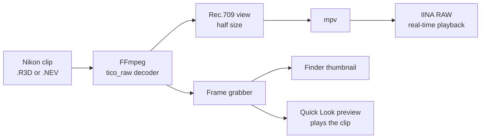

# nikon-raw-playback

**Watch Nikon raw video clips on a Mac in real time.** A clean-room TICO RAW decoder for FFmpeg,
and IINA RAW, an unofficial IINA-based player that plays `.R3D` and `.NEV` clips.

-lightgrey)


<!-- screenshot: IINA RAW playing a Nikon ZR clip, with a Finder window of clip thumbnails next to it -->

## ⬇️ Download

**[Get IINA RAW from the latest release](https://github.com/alperkaganavci/nikon-raw-playback/releases/latest)**
(file: `IINA-RAW-1.5.1-raw.1-arm64.dmg`).

You need an Apple Silicon Mac. The app was tested on macOS 27.3 only. The app says macOS 12 is
the minimum, but older versions are untested. The app is not notarized, so macOS blocks the
first launch. See [Install](#-install) below.

## ✨ What you get

- 🎞️ **Real-time playback.** The 6K test clip plays at 25 fps with no dropped frames.
- 🖼️ **Finder thumbnails.** Each `.R3D` and `.NEV` clip gets a frame as its icon.
- 👀 **Quick Look preview.** Press the space bar on a clip and it plays.
- 🧪 **Tested numbers.** Decoding is byte-exact against a reference decoder on the test frames.
  Every number in this project is in [`docs/results.md`](docs/results.md).

## 🚦 Status

| | What | State |
| --- | --- | --- |
| 🟢 | R3D NE (`.R3D`) from a Nikon ZR, 6060 × 3410, 25 fps | Works. Exact decoding, real-time playback, fast seeks, audio in sync. Tested on one clip. |
| 🟢 | Finder thumbnails and Quick Look preview | Works. About 0.3 s per thumbnail. The preview plays at about 22 to 24 fps. |
| 🟡 | N-RAW (`.NEV`) | Partly. Tested only with a lossless rewrapped copy of the R3D NE clip. |
| 🟡 | Colour | Partly. The Rec.709 view is a quick look, not a grade. `.RMD` sidecar files are ignored. |
| 🟡 | Full-size view (`view_size=full`) | Partly. It decodes at about 16 fps, so it does not play in real time. |
| 🔴 | Real N-RAW clips from a Z8, Z9 or Z6III | Not tested yet. |
| 🔴 | Other ZR modes (4K, 50, 60 and 120 fps) and other cameras | Not tested yet. |
| 🔴 | CFA patterns other than RGGB | Not tested yet. |

All numbers come from one Nikon ZR clip (R3D NE, 6060 × 3410, 25 fps, 819 frames) on an Apple
Silicon Mac. Methods and details: [`docs/results.md`](docs/results.md).

## 📦 Install

Do this only if you trust the source of the download. If you prefer, you can
[build the app yourself](#-build-from-source) from the public sources.

1. Download `IINA-RAW-1.5.1-raw.1-arm64.dmg` from the
   [latest release](https://github.com/alperkaganavci/nikon-raw-playback/releases/latest).
2. Open the DMG. Drag **IINA RAW** to **Applications**.
3. Open IINA RAW. macOS blocks the first launch, because the app is ad-hoc signed and not
   notarized. Use one of these fixes:
   - Open **System Settings → Privacy & Security** and click **Open Anyway**.
   - Or run this in Terminal:
     ```
     xattr -dr com.apple.quarantine "/Applications/IINA RAW.app"
     ```
4. Open IINA RAW once. Then Finder registers the thumbnail and preview extensions.
   If thumbnails do not show, run `qlmanage -r` and `qlmanage -r cache`, then reopen Finder.

IINA RAW 1.5.1-raw.1 has no auto-update. The IINA updater is turned off, so it can never
replace the app with stock IINA. New versions come as new GitHub releases.

How to use the app: [`docs/HOW-TO-USE.md`](docs/HOW-TO-USE.md).

## 🔧 How it works



Four parts make the app:

| Part | Where | What it holds |
| --- | --- | --- |
| This repository | `alperkaganavci/nikon-raw-playback`, branch `main` | Docs, tools, tests and the build script |
| FFmpeg fork | [`alperkaganavci/FFmpeg`](https://github.com/alperkaganavci/FFmpeg), branches `tico-raw` (on master) and `tico-raw-9.0` (on FFmpeg 9.0.2) | The `tico_raw` decoder |
| IINA fork | [`alperkaganavci/iina`](https://github.com/alperkaganavci/iina), branch `iina-raw` | IINA 1.5.1 renamed to IINA RAW, with the Quick Look extensions |
| IINA libraries | [`iina/deps-buildscripts`](https://github.com/iina/deps-buildscripts) at `ee35579d` | FFmpeg, mpv, libplacebo and other libraries (47 in all) |

The patch `build/patches/ffmpeg-9.0.2-tico_raw.patch` puts the decoder into the libraries build.

What is in this repository:

| Path | What it holds |
| --- | --- |
| `docs/format/tico-raw-nikon.md` | The format note: container, Nikon wrapper, codestream, every decoding stage, the viewing transform |
| `docs/design.md` | Goals, architecture, decoder stages, view transform, delivery |
| `docs/clean-room.md` | The clean-room rules and which sources each file used |
| `docs/results.md` | Measurements and methods |
| `docs/HOW-TO-USE.md` | How to use IINA RAW |
| `build/` | `build-iina-raw.sh`, `make-dmg.sh`, their README and the patches |
| `tools/` | Frame extraction, stage compare, latency tool, install script, reference renderer scripts |
| `tests/` | The decoder checks, the playback check and the unit tests |
| `oracle/` | The black-box reference harness. It links blue-compressor as a library. It is not part of the decoder. |

## 🔨 Build from source

You need an Apple Silicon Mac, Xcode and a few Homebrew packages. Then run:

```
build/build-iina-raw.sh
```

The first run takes tens of minutes. The steps, the options and what to do when something
fails are in [`build/README.md`](build/README.md). The same file says how to make an installer
DMG from a built app.

## ✅ Run the tests

The tests need a Nikon ZR clip and reference files. The repository does not hold them
(`testdata/` is git-ignored). Make them from your own clip:

```
export CLIP=/path/to/clip.R3D

# frame samples
mkdir -p testdata/samples
for i in 0 100 818; do tools/extract_frame.py "$CLIP" $i testdata/samples/f$(printf %04d $i).bin; done

# reference dumps (needs Rust; the oracle builds blue-compressor 4d35f31)
oracle/run.sh "$CLIP" testdata/ref/A015_C004 0 100 818

# reference views (the first command builds the oracle CLI into testdata/oracle-bin)
tools/oracle_render.sh --exact "$CLIP" testdata/ref/view-p010
tools/oracle_render.sh "$CLIP" testdata/ref/view

```

The checks that use the N-RAW copy (`testdata/ref/A015_C004_nraw.NEV`, a lossless rewrap of the
clip) fail with "missing file" when it is absent. The blue-compressor command line can make it
(`bluecompress --rewrap --to-nev`). That command is **untested** here, so check its options
with `bluecompress --help`.

Then build the FFmpeg decoder (see [`build/README.md`](build/README.md), section "Only the
decoder") and run the checks:

```
FFMPEG_BUILD=/path/to/ffmpeg-build CLIP=$CLIP tests/decoder_checks.sh all   # decoder checks
CLIP=$CLIP python3 tests/test_tools.py                                       # tool unit tests
CLIP=$CLIP tests/test_playback.sh                                            # needs IINA RAW installed
```

The shell scripts stop with a clear message when `CLIP` or `FFMPEG_BUILD` is not set;
`tests/test_tools.py` skips its clip tests instead. The
Quick Look checks also need `IINA_RAW_SRC`, a checkout of
[`alperkaganavci/iina`](https://github.com/alperkaganavci/iina) (branch `iina-raw`) with
`deps/lib` filled by the build.

## 🧼 Clean-room development

The decoder authors never read the source of blue-compressor, the program that decodes this
codec in Rust. Someone else read it once, and wrote down the facts of the format in
[`docs/format/tico-raw-nikon.md`](docs/format/tico-raw-nikon.md). The decoder authors used only
that note, FFmpeg, public standards and the bytes of the clips. blue-compressor ran as a black
box and gave reference output. The rules and the evidence for each file are in
[`docs/clean-room.md`](docs/clean-room.md).

Most of the code and documentation was written with AI assistance, under the clean-room
process and the reviews described here.

## ⚖️ Patents

TICO RAW is intoPIX technology, a JPEG XS variant. Patent rules can apply to it, as they do to
other codecs that FFmpeg ships. This note is not legal advice. Check the rules that apply to
you before you ship the decoder.

## 🙏 Credits

- [FFmpeg](https://ffmpeg.org): the decoder is an FFmpeg decoder, and the build uses FFmpeg 9.0.2.
- [IINA](https://github.com/iina/iina): IINA RAW is a fork of IINA 1.5.1.
- [mpv](https://mpv.io) and [libplacebo](https://code.videolan.org/videolan/libplacebo): the
  player core and the renderer that IINA uses.
- [blue-compressor](https://github.com/redn3/blue-compressor) by its authors (Apache-2.0): the
  black-box reference for the stage checks. Its `NOTICE` mentions
  [rawmakase](https://github.com/pch/rawmakase) (MIT, "Copyright (c) 2026 RAWmakase
  contributors"). The provenance is recorded in [`docs/clean-room.md`](docs/clean-room.md).
- [SVT-JPEG-XS](https://github.com/OpenVisualCloud/SVT-JPEG-XS) (Intel, BSD-2-Clause-Patent):
  used in the phase-0 study. See [`docs/results.md`](docs/results.md).

## 📄 Licence

- The code and scripts in this repository: MIT ([`LICENSE`](LICENSE)). Exceptions: the file
  `build/patches/ffmpeg-9.0.2-tico_raw.patch` is under the licence of the FFmpeg fork, and
  `build/patches/deps-buildscripts.patch` changes one line of `iina/deps-buildscripts` (our line is
  MIT; its two context lines belong to that project). See [`LICENSE-docs`](LICENSE-docs).
- The documentation (`README.md`, `build/README.md` and `docs/`): CC BY 4.0
  ([`LICENSE-docs`](LICENSE-docs)).
- The FFmpeg fork: LGPL-2.1-or-later, the licence of FFmpeg.
- The IINA fork: GPL-3.0, the licence of IINA.

## 🚫 Not affiliated

IINA RAW is an unofficial fork of IINA. This project is not affiliated with Nikon, intoPIX,
RED, the IINA project or the FFmpeg project. Nikon, N-RAW, RED and the other names are
trademarks of their respective holders.
